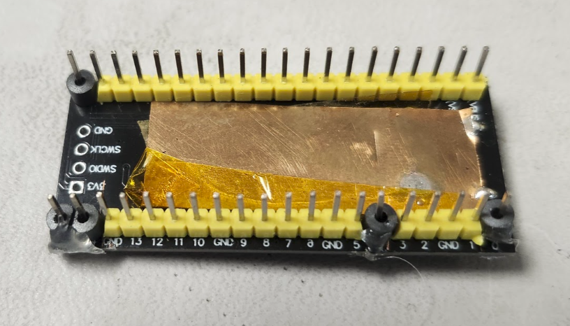
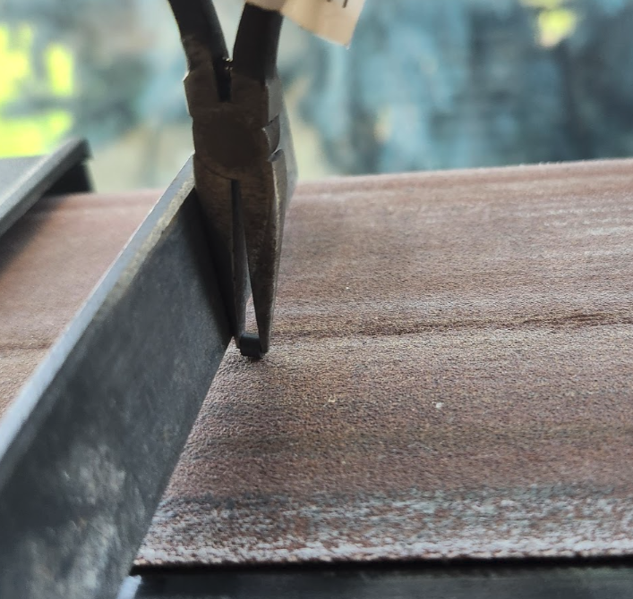

# Modifying Your YD-RP2040 to be EMI Tollerant

You can also do this with the Raspberry Pi Pico if you want to be sure the 2 ns square wave edges on the outputs of the iCE40UP5K do not mess with your SDR.  I found that the sharp edges of the FPGA outputs coupled with the poor PCB design of the YD-RP2040's USB D+ and D- wires caused USB Error (71) to occur occasionally with the YD-RP2040.  Many FPGAs and the RP2040 itself have a way to reduce the current drive of outputs.  Unfortunately, the iCE40UP5K does not.  The Raspberry Pi Pico with better wiring worked okay without modificationns.  Really this should be fixed on the Pico-Dev-iCE PCB, by putting 200 Ohm resistors on the FPGA outputs.  I did this on the v0.15 board, so the next spin will have this fixed.  

### Modification Options

#### Emulate the v0.15 PCB

You could possibly modify your PCB to match v0.15, by scraping a little of the solder mask on the traces, cutting and jumping the output wires with 200 Ohm resistors soldered to the scaped edges.  These resistors should be placed close to the FPGA, not to the Pico.  I did not do this modification.  I did the modification below using ferrite beads instead.  I thought this was going to be difficult and that one was pretty easy. If you do this modification, please report back to me how it went.  I can give you some test code so you can see if my expectation that it fixes the issue are actually realized.

#### Add Ferrite Beads to the Processor Board

This may not be quite as good as the first option, but it is easy and it made a YD-RP2040 that was getting many (71) USB errors before the mod have none afterwards.

As shown above, the goal is to add five ferrite beads to the YD-RP2040 along with a shield.  The beads attenuate the higher frequencies in the square wave signals coming from the FPGA. On the YD-RP2040, the D+ and D- traces go on the bottom of the board, without a continuous ground plane on the other side.  The vias, the fact that the source resistors were not put close to the RP2040 and the lack of a continuous groundplane make the YD-RP2040 susceptible to EMI.  The shield is soldered to the ground connections of the USB C port that come through the PCB.  I put kapton tape on the other side of the copper to make sure it would not short through hole connection points on the back of the board to ground.  To put the beads on GPIO14 and GIO15 (right next to one another), I had to grind a little of the ferrite bead off so they would both fit.  I used the belt sander in the Analog Lab with a pair of needle nose pliers.

I used hot glue to make it so the ferrite beads would not fall off when the YD-RP2040 was removed.  I used a knife to cut the yellow header.  You can remove the plastic pieces after they seperate from the rest of the header you severed them from.  Just slide them up the pins.